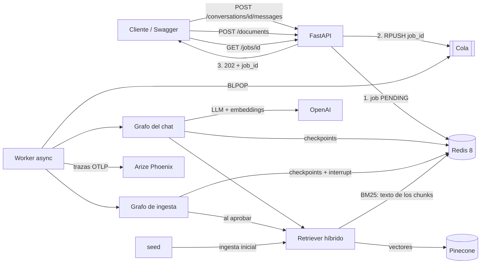
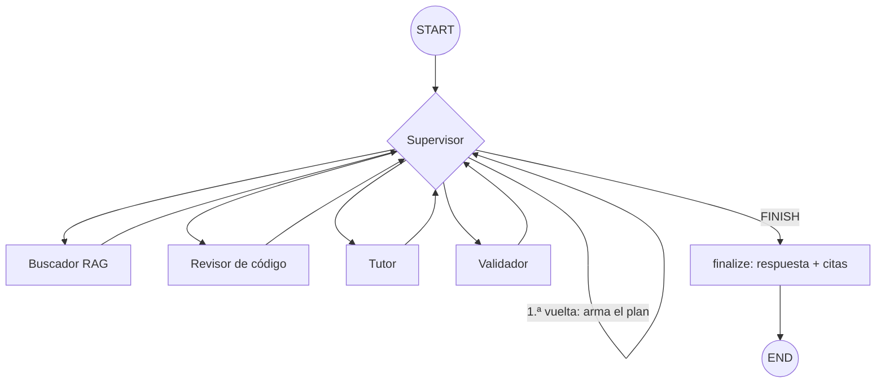
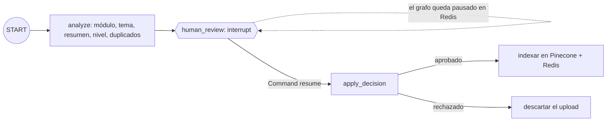
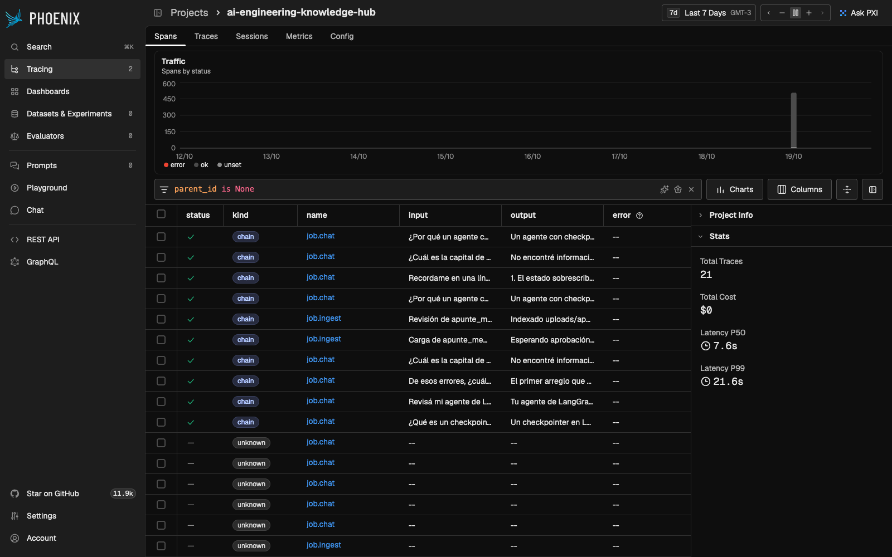
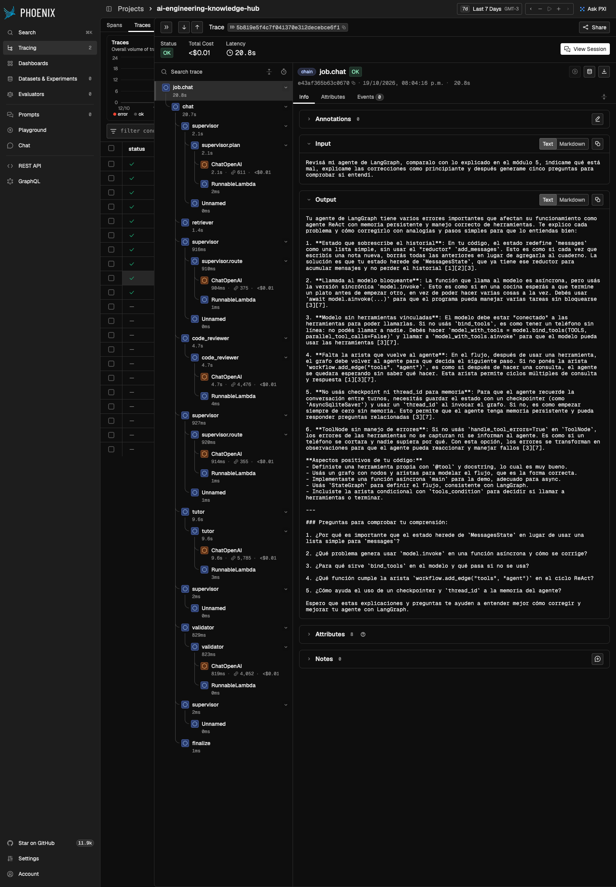
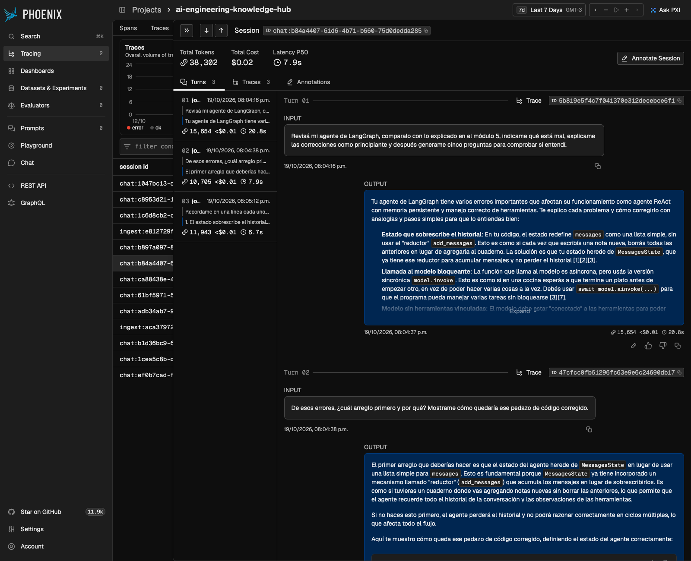
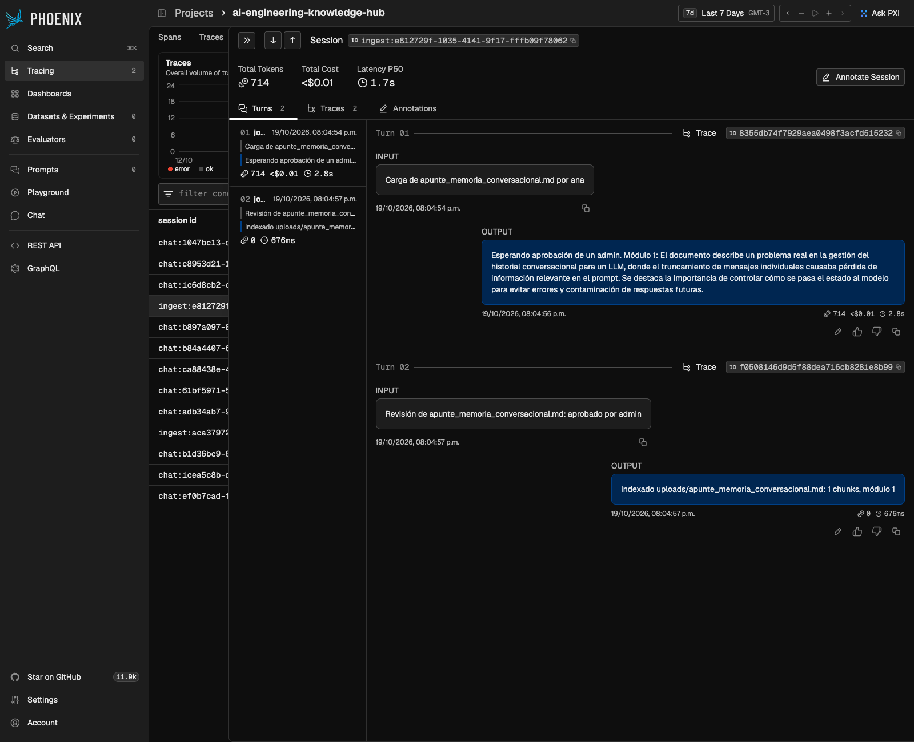
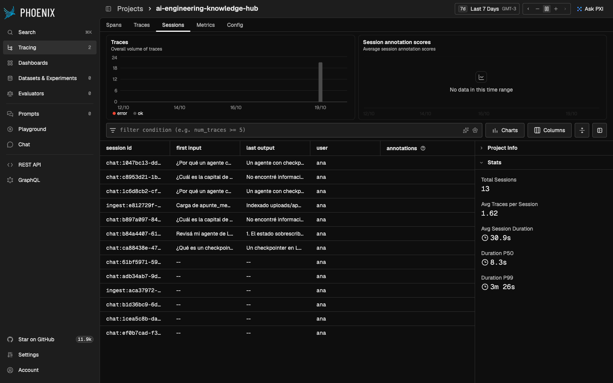

# AI Engineering Knowledge Hub

Sistema de IA de grado de producción para un equipo que estudia AI Engineering: los integrantes
suben su material (apuntes, notebooks, código, presentaciones) a una base compartida y le hacen
preguntas a un tutor que responde **solo con ese material**, citando la fuente de cada
afirmación. El tutor también revisa código contra lo explicado en el curso, adapta la
explicación al nivel del alumno y arma cuestionarios.

Integra las siete pre-entregas del curso: **RAG híbrido** (BM25 + Pinecone) → **Supervisor
multi-agente** en LangGraph → **API FastAPI** con cola en Redis y worker separado →
**checkpointer persistente** (`AsyncRedisSaver`) → **trazabilidad** completa en Arize Phoenix.

> **Estado de la evidencia:** completa. El 19/10/2026 se ejecutaron las corridas reales con
> `gpt-4.1-mini`, `text-embedding-3-small` y Pinecone. El costo total fue **USD 0,09**. Ver
> [Evidencia de las corridas reales](#evidencia-de-las-corridas-reales).

## Índice

- [Qué resuelve](#qué-resuelve)
- [Cómo cubre la consigna](#cómo-cubre-la-consigna)
- [Arquitectura](#arquitectura)
- [Grafo del chat: Supervisor y especialistas](#grafo-del-chat-supervisor-y-especialistas)
- [Grafo de ingesta con aprobación humana](#grafo-de-ingesta-con-aprobación-humana)
- [RAG híbrido](#rag-híbrido)
- [API](#api)
- [Levantar el sistema](#levantar-el-sistema)
- [Probarlo paso a paso](#probarlo-paso-a-paso)
- [Evidencia de las corridas reales](#evidencia-de-las-corridas-reales)
- [Problemas reales encontrados y corregidos](#problemas-reales-encontrados-y-corregidos)
- [Observabilidad](#observabilidad)
- [Tests y calidad](#tests-y-calidad)
- [Decisiones de diseño](#decisiones-de-diseño)
- [Limitaciones conocidas](#limitaciones-conocidas)
- [Qué se reutilizó de cada pre-entrega](#qué-se-reutilizó-de-cada-pre-entrega)

## Qué resuelve

Una consulta típica, que es también la demo principal:

> *"Revisá mi agente de LangGraph, comparalo con lo explicado en el módulo 5, indicame qué está
> mal, explicame las correcciones como principiante y después generame cinco preguntas para
> comprobar si entendí."*

Para responderla, el sistema necesita:

1. **Conocimiento específico** (RAG): qué se enseñó en el módulo 5, con fragmentos citables.
2. **Razonamiento multi-paso** (agentes): buscar → revisar el código contra el material →
   explicar en el nivel pedido → armar el cuestionario → validar que todo tenga respaldo.
3. **Memoria**: la repregunta *"de esos errores, ¿cuál arreglo primero?"* tiene que entenderse
   sin repetir el código, incluso después de reiniciar el servidor.
4. **Control de calidad de la base**: nada entra a la base compartida sin que un admin lo
   apruebe, para que un documento erróneo no contamine las respuestas de todo el equipo.

## Cómo cubre la consigna

| Requisito | Dónde está |
|---|---|
| Acceso a conocimiento específico (RAG) | [app/rag/](app/rag/): loaders de PDF/HTML/MD/PY/IPYNB, chunking por tokens, BM25 + Pinecone fusionados con RRF |
| Razonamiento multi-paso con Supervisor | [app/agents/chat_graph.py](app/agents/chat_graph.py): Supervisor con LLM + 4 especialistas |
| API profesional y documentada | [app/main.py](app/main.py): FastAPI, Swagger en `/docs`, validación Pydantic, 202 + polling |
| Todo async | `ainvoke`, `AsyncOpenAI`, `PineconeAsyncio`, `redis.asyncio`, `httpx` en el cliente |
| Checkpointer de LangGraph | `AsyncRedisSaver` en API y worker; la conversación sobrevive a `docker compose restart` |
| Validación con Pydantic | Requests de la API, herramientas (`SearchQuery`, `SearchFilter`), salidas estructuradas de cada agente y configuración |
| Trazabilidad | Phoenix vía OpenTelemetry/OpenInference: un trace por job, agrupado por sesión |
| Sin hard-coding | Índice, namespace, región, modelos y límites salen de variables de entorno ([app/config.py](app/config.py)) |
| Despliegue local | `docker compose up --build` levanta Redis, Phoenix, seed, API y worker |

## Arquitectura



| Componente | Responsabilidad | Qué no hace |
|---|---|---|
| **API** (FastAPI) | Valida, identifica al usuario, persiste el job, encola y responde 202 | Nunca ejecuta un LLM dentro del request |
| **Worker** | Consume la cola y ejecuta (o reanuda) el grafo que corresponde | No atiende HTTP |
| **Redis 8** | Jobs, cola, conversaciones, checkpoints de LangGraph y texto de los chunks | No razona |
| **Pinecone** | Búsqueda vectorial densa | No guarda el texto para BM25 |
| **seed** | Indexa `sample_docs/` y `knowledge_base/` antes de que arranquen API y worker | No pasa por aprobación: lo carga quien administra el repo |
| **Phoenix** | Recibe las trazas y calcula tokens, costo y latencia | No reemplaza los tests |

### Estados de un job

```text
chat:    PENDING → RUNNING → DONE | FAILED
ingesta: PENDING → RUNNING → WAITING_APPROVAL ──(admin aprueba o rechaza)──→ PENDING → RUNNING → DONE
```

Una conversación acepta **un turno a la vez**: si llega una pregunta mientras la anterior se está
procesando, la API responde **409**. Así dos turnos no escriben el mismo hilo del checkpointer
en paralelo.

## Grafo del chat: Supervisor y especialistas



| Agente | Qué hace | Salida (Pydantic) |
|---|---|---|
| **Supervisor** | En la primera vuelta arma un `RequestPlan` (intención, búsquedas, módulos, si hay cuestionario). En cada vuelta elige el próximo paso con un LLM | `RequestPlan`, `SupervisorDecision` |
| **Buscador RAG** | Corre las búsquedas en paralelo sobre el retriever híbrido. Si el Validador pide más respaldo, reformula las búsquedas | Fragmentos numerados `[n]` |
| **Revisor de código** | Compara el código del alumno con los fragmentos: problemas con severidad, línea, corrección y fuentes | `CodeReview` |
| **Tutor** | Redacta la respuesta en el nivel pedido (principiante, intermedio o avanzado), con citas `[n]` y cuestionario opcional | `TutorAnswer` |
| **Validador** | Primero un control determinístico (que las citas existan y que haya citas, o que diga "no encontré"). Después un LLM verifica que cada afirmación tenga respaldo | `ValidationReport` |

**Barandas del Supervisor.** El LLM decide, pero solo entre los pasos que la política permite
según el estado (`allowed_routes`): no puede terminar sin pasar por el Validador, no revisa
código si no hay código y tiene un tope de vueltas y de revisiones. Si elige algo fuera de la
lista, se corrige y queda registrado como `policy_override` en `supervisor_log`. Si hay una sola
opción válida, ni siquiera se llama al LLM, lo que ahorra latencia y costo.

**Respuestas honestas.** Si el material no alcanza, el Tutor responde "No encontré esto en el
material del curso" en lugar de completar con conocimiento propio. Si el Validador sigue
rechazando después de la revisión permitida, la respuesta se entrega con una advertencia visible.

## Grafo de ingesta con aprobación humana



1. Cualquier usuario sube un archivo con `POST /documents` (máximo 10 MB, 6 tipos).
2. Un agente lo analiza: infiere módulo, tema y dificultad, lo resume, detecta problemas de
   calidad y busca posibles duplicados en la base.
3. El grafo se pausa con `interrupt()` y el job pasa a `WAITING_APPROVAL`. El checkpoint queda
   en Redis, así que **sobrevive a un reinicio del worker**.
4. Un admin (`ADMIN_USERS`) lo ve en `GET /documents/reviews` y lo aprueba o lo rechaza. Puede
   **corregir el módulo o el tema** que infirió el agente.
5. El worker reanuda el grafo con `Command(resume=...)` y recién entonces el documento entra a
   la base. El índice BM25 de cada proceso se reconstruye cuando cambia la versión del corpus.

## RAG híbrido

| Pieza | Decisión |
|---|---|
| Loaders | PDF (`pypdf`), HTML (`BeautifulSoup`), Markdown, `.py`, `.ipynb` (celdas de código y markdown) y `.txt`. El módulo se deduce de la ruta (`modulo_05_...`, `Clase_4`, `Entrega 7`) |
| Chunking | Por tokens con `tiktoken` (450 con 50 de solapamiento). Para código, los cortes preferidos son `class` y `def` |
| Metadatos | Módulo, tipo de documento, tema, título, fuente, quién lo subió y quién lo aprobó. Se filtra por módulo y tipo en las dos ramas |
| Recuperación | BM25 (palabras exactas como `AsyncRedisSaver` o `lru_cache`) + vectores (significado), fusionados con **Reciprocal Rank Fusion** ponderado (`BM25_WEIGHT`) |
| Filtro por módulo | Si lo elige el usuario, es estricto. Si lo infiere el LLM, es una **preferencia**: se busca filtrado y sin filtrar y se combinan los resultados (ver [problema 3](#3-un-documento-mal-clasificado-quedaba-invisible)) |
| Idempotencia | El ID de un documento sale de su ruta: reindexarlo reemplaza sus chunks en lugar de duplicarlos |

**Modo sin cuentas externas.** Con `EMBEDDING_PROVIDER=hash` y `VECTOR_STORE=local`, todo
funciona sin OpenAI ni Pinecone (embeddings determinísticos y vectores en Redis). Sirve para los
tests y para que cualquiera pueda levantar el sistema sin keys.

## API

Toda la documentación interactiva está en **http://localhost:8000/docs**. El usuario se
identifica con el header `X-User-Id` (ver [limitaciones](#limitaciones-conocidas)).

| Método y ruta | Qué hace | Códigos |
|---|---|---|
| `POST /conversations` | Crea una conversación | 201 |
| `GET /conversations` | Lista las conversaciones del usuario | 200 |
| `GET /conversations/{id}` | Historial, leído **del checkpointer** de LangGraph | 200, 404 |
| `POST /conversations/{id}/messages` | Pregunta. Body: `question`, `code` (opcional), `level`, `modules` | 202, 404, **409** si hay un turno en curso, 422 |
| `GET /jobs/{id}` | Estado y resultado: respuesta, citas, revisión de código, cuestionario, validación y agentes usados | 200, 404 |
| `POST /documents` | Sube un archivo (multipart, con `module` opcional) | 202, 413, 415, 422 |
| `GET /documents/reviews` | Documentos esperando aprobación (**solo admins**) | 200, 403 |
| `POST /documents/reviews/{job_id}` | Aprueba o rechaza. Body: `approved`, `comment`, `module`, `topic` | 202, 403, 404, 409 |
| `GET /documents` | Catálogo de la base | 200 |
| `GET /health` | Estado de Redis, modo de agentes, vector store y cantidad de documentos | 200 |

Si Redis no está disponible, la API responde **503 con `Retry-After`** en lugar de un 500.

## Levantar el sistema

### Requisitos

- Docker Desktop con Docker Compose 2.24 o superior.
- Para desarrollar o correr los tests: Python 3.12 o 3.13.
- Solo para las corridas reales: una `OPENAI_API_KEY` y una `PINECONE_API_KEY` (el plan
  gratuito de Pinecone alcanza; el índice se crea solo).

### Opción A: sin keys (modo simulado)

```bash
docker compose up --build
```

Sin `.env`, el stack arranca con agentes determinísticos, embeddings `hash` y vectores en Redis.
Sirve para recorrer la API, el flujo de aprobación, la persistencia y las trazas sin gastar.

### Opción B: modo real

```bash
cp .env.example .env
# editar .env:
#   AGENT_MODE=openai
#   EMBEDDING_PROVIDER=openai
#   VECTOR_STORE=pinecone
#   OPENAI_API_KEY=...
#   PINECONE_API_KEY=...
docker compose up --build
```

`.env` está en `.gitignore`. Las keys van **solo** ahí, nunca en `.env.example`.

| Servicio | URL |
|---|---|
| API y Swagger | http://localhost:8000/docs |
| Phoenix | http://localhost:6006 (proyecto `ai-engineering-knowledge-hub`) |

### Variables de entorno

| Variable | Default | Para qué |
|---|---|---|
| `AGENT_MODE` | `simulated` | `simulated` o `openai` |
| `OPENAI_MODEL` | `gpt-4.1-mini` | Modelo de los agentes |
| `EMBEDDING_PROVIDER` / `EMBEDDING_MODEL` | `hash` / `text-embedding-3-small` | Embeddings |
| `VECTOR_STORE` | `local` | `local` (Redis) o `pinecone` |
| `PINECONE_INDEX` / `PINECONE_NAMESPACE` | `ai-engineering-knowledge-hub` / `course` | Índice y namespace |
| `PINECONE_CLOUD` / `PINECONE_REGION` | `aws` / `us-east-1` | Dónde se crea el índice serverless |
| `CHUNK_SIZE` / `CHUNK_OVERLAP` | `450` / `50` | Chunking en tokens |
| `TOP_K` / `BM25_WEIGHT` | `6` / `0.5` | Recuperación y peso de BM25 en la fusión |
| `MAX_UPLOAD_MB` | `10` | Tamaño máximo de un upload |
| `MAX_GRAPH_STEPS` / `MAX_REVISIONS` | `24` / `1` | Topes del Supervisor |
| `ADMIN_USERS` | `admin` | Quiénes aprueban documentos (separados por coma) |
| `REDIS_URL` | `redis://localhost:6379` | En Compose se pisa con `redis://redis:6379` |
| `PHOENIX_COLLECTOR_ENDPOINT` / `PHOENIX_PROJECT_NAME` | `http://localhost:6006/v1/traces` / `ai-engineering-knowledge-hub` | Trazas |

Si falta una key que el modo elegido necesita, el sistema **falla al arrancar** con un mensaje
claro, no en la primera pregunta.

### Agregar tu propio material

El repo incluye `sample_docs/`: 16 documentos propios (READMEs y código de las pre-entregas y un
glosario) que dan unos 140 chunks. Para usar el material del curso, copialo en
`knowledge_base/` respetando carpetas por módulo (`knowledge_base/modulo_04_rag/...`) y volvé a
levantar el stack: el servicio `seed` lo indexa.

`knowledge_base/` está en `.gitignore` y se monta como solo lectura en el contenedor (no se
copia a la imagen), porque el material de Coderhouse no se puede publicar.

### Desarrollo local

```bash
python3.12 -m venv .venv
source .venv/bin/activate
python -m pip install -e ".[dev]"
```

## Probarlo paso a paso

[scripts/demo_client.py](scripts/demo_client.py) es un cliente async con `httpx` que crea la
conversación, hace polling del job e imprime el JSON. Con el stack levantado:

```bash
# 1. Pregunta simple
python scripts/demo_client.py ask "¿Qué es un checkpointer?" --level principiante

# 2. La consulta multipaso, con un agente que tiene 5 errores a propósito
python scripts/demo_client.py ask "Revisá mi agente de LangGraph, comparalo con lo explicado en el módulo 5, indicame qué está mal, explicame las correcciones como principiante y después generame cinco preguntas para comprobar si entendí." \
  --level principiante --code-file examples/agente_con_errores.py

# 3. Repregunta en la misma conversación (conversation_id sale del paso anterior)
python scripts/demo_client.py ask "De esos errores, ¿cuál arreglo primero?" --conversation <ID>

# 4. Carga con aprobación humana
python scripts/demo_client.py upload examples/apunte_memoria_conversacional.md   # queda WAITING_APPROVAL
python scripts/demo_client.py review <JOB_ID> --approve                          # como admin

# 5. Persistencia: reiniciar todo y seguir la conversación
docker compose restart
python scripts/demo_client.py history <ID>
```

## Evidencia de las corridas reales

Corridas del 19/10/2026 con `AGENT_MODE=openai` (`gpt-4.1-mini`), `text-embedding-3-small` y
Pinecone serverless. Las respuestas completas están en [docs/evidencia/](docs/evidencia/) y las
métricas salen de Phoenix. La primera tanda, anterior a las correcciones 1 a 5, quedó en
[docs/evidencia/v1/](docs/evidencia/v1/).

| # | Prueba | Agentes | Resultado | Latencia | Tokens | Costo |
|---|---|---|---|---|---|---|
| 1 | Pregunta conceptual, nivel principiante | Buscador → Tutor → Validador | Respuesta con 4 citas, aprobada | 8,0 s | 8 781 | USD 0,0040 |
| 2 | **Consulta multipaso** con [un agente con errores](examples/agente_con_errores.py) | Buscador → Revisor → Tutor → Validador | Encontró **los 5 errores sembrados** (más 1 mejora) con su línea, explicó las correcciones para principiante y armó 5 preguntas | 20,8 s | 15 654 | USD 0,0081 |
| 3 | Repregunta en la misma conversación | Buscador → Tutor → Validador | Entendió "de esos errores" sin repetir el código | 7,9 s | 10 705 | USD 0,0048 |
| 4 | Pregunta fuera del material (capital de Australia) | Buscador → Tutor → Validador | "No encontré información… en el material del curso", sin citas | 10,6 s | 8 074 | USD 0,0024 |
| 5a | Upload de un apunte | Agente de ingesta | `WAITING_APPROVAL` con análisis; `ana` recibe **403** al intentar aprobar | 2,8 s | 714 | USD 0,0004 |
| 5b | Aprobación del admin | Reanudación con `Command(resume)` | Indexado: la base pasa de 16 a 17 documentos | 0,7 s | 0 | USD 0 |
| 5c | Pregunta que necesita el apunte nuevo | Buscador → Tutor → Validador | Cita `uploads/apunte_memoria_conversacional.md` | 8,4 s | 9 724 | USD 0,0044 |
| 6 | `docker compose restart` y repregunta | Buscador → Tutor → Validador | Recordó los 6 puntos de la revisión del turno 1; el historial leído del checkpointer tiene 6 mensajes | 6,8 s | 11 943 | USD 0,0048 |

### Capturas de Phoenix

**Trazas del proyecto.** Cada job es una traza de tipo `chain` con la pregunta como entrada y
la respuesta como salida. Las de abajo, con tipo `unknown`, son de la primera tanda, antes de
la corrección del [problema 5](#5-las-trazas-raíz-eran-una-caja-negra).



**Consulta multipaso.** El árbol muestra cada vuelta del Supervisor (`supervisor.plan`,
`supervisor.route`), los especialistas y cada llamada a `ChatOpenAI` con tokens y costo.



**Persistencia.** Los 3 turnos de la conversación quedan en la misma sesión; el tercero se
ejecutó después de `docker compose restart`.



**Aprobación humana.** La carga es una sesión con dos trazas: el análisis que termina en
"Esperando aprobación" y la reanudación tras la decisión del admin.



**Sesiones.** Cada conversación y cada carga es una sesión, con su usuario.



## Problemas reales encontrados y corregidos

Estos problemas aparecieron al correr el sistema de verdad (en Docker o con OpenAI), no en los
tests. Cada corrección tiene un test de regresión.

### 1. La memoria "olvidaba" parte de la conversación

**Síntoma:** después del reinicio, *"recordame los errores que encontraste"* listaba 4 de 5.
**Causa:** el checkpointer tenía todo, pero el historial que se arma para el prompt cortaba cada
mensaje en 1 500 caracteres, y la respuesta con revisión y cuestionario tenía 4 058.
**Corrección:** tope de 6 000 por mensaje (`HISTORY_CHARS_PER_MESSAGE`); el total se controla con
la ventana de los últimos 6 mensajes. Las corridas fallidas están en
[docs/evidencia/bug_historial/](docs/evidencia/bug_historial/).

### 2. Una respuesta equivocada contamina los turnos siguientes

Al repetir la pregunta en la misma conversación después de corregir el bug 1, la respuesta fue
idéntica a la equivocada: el modelo veía en el historial la respuesta original (5 errores) y la
incorrecta (4), y copiaba la más reciente. Por eso la prueba final se hizo en una conversación
nueva. Es una limitación de cualquier memoria basada en historial, y está documentada abajo.

### 3. Un documento mal clasificado quedaba invisible

**Síntoma:** la pregunta sobre el apunte recién aprobado no lo citaba.
**Causa:** el agente de ingesta lo clasificó como módulo 1, el Supervisor infirió módulo 5 para
la pregunta y el filtro estricto lo dejó afuera. Sin filtro, el apunte salía primero.
**Corrección:** los módulos que infiere el LLM pasan a ser una preferencia (búsqueda filtrada +
sin filtrar, combinadas); los que elige el usuario siguen siendo estrictos.

### 4. El control de citas rechazaba un "no encontré" válido

La regla determinística solo aceptaba la frase literal "No encontré esto en el material", y
`gpt-4.1-mini` respondió "No encontré información sobre X en el material". Eso forzaba una
revisión innecesaria. La expresión regular ahora acepta las variantes.

### 5. Las trazas raíz eran una caja negra

En Phoenix, cada job aparecía como tipo `unknown`, sin estado y sin entrada ni salida, y las
sesiones mostraban `--`. Ahora el span raíz lleva `openinference.span.kind=CHAIN`, `input.value`,
`output.value` y estado `OK` (o `ERROR` con la excepción).

### 6. Se perdían trazas al reiniciar

`docker compose restart` manda SIGTERM. Python moría sin enviar el último lote de spans y la
traza del job anterior al reinicio nunca llegaba a Phoenix. El worker ahora atrapa la señal,
cancela su loop ordenadamente y llama a `force_flush()` antes de salir.

### 7. Error 500 después de que Redis se reiniciaba

La API reutilizaba conexiones muertas del pool. El cliente Redis compartido
([app/redis_client.py](app/redis_client.py)) verifica las conexiones ociosas y reintenta con
backoff; si Redis sigue caído, la API responde 503 con `Retry-After`.

## Observabilidad

- **Un trace por job** (`job.chat` o `job.ingest`) con `job.id`, `job.kind`, `job.outcome`,
  `job.resume` y `agent_mode`. Debajo, cada nodo del grafo y cada llamada al LLM.
- **Sesiones:** el `session_id` es el mismo `thread_id` del checkpointer (`chat:<conversación>` o
  `ingest:<job>`), así Phoenix agrupa todos los turnos de una conversación y las dos mitades de
  una carga con aprobación.
- **Solo se instrumenta LangChain.** Sumar el instrumentor de OpenAI duplica cada llamada y el
  costo (lección de la Pre-entrega 7).
- **Logs** con `job=<id> kind=<tipo> outcome=<resultado>` para cruzarlos con las trazas.
- El costo exacto se obtiene con la query GraphQL `costSummary`: la interfaz muestra los montos
  menores a un centavo como `<$0.01`.

## Tests y calidad

```bash
pytest          # 48 tests, sin red ni keys
ruff check .
ruff format --check .
mypy            # strict
```

- **Tests offline**: el circuito completo API → Redis (`fakeredis`) → worker → grafo → API, con
  el backend simulado.
- **Integración con el `ChatOpenAI` real**: [tests/test_openai_backend.py](tests/test_openai_backend.py)
  reemplaza solo la llamada HTTP (`_agenerate`), así se ejercita el armado del `response_format`
  y el parseo de las salidas estructuradas, que es donde fallan los fakes.
- **Casos cubiertos**: política del Supervisor y correcciones (`policy_override`), revisiones
  agotadas, citas inválidas, filtro por módulo, historial largo, permisos de admin, turnos
  concurrentes (409), Redis caído (503), uploads inválidos (413, 415, 422) y atributos de las
  trazas.

## Decisiones de diseño

| Decisión | Por qué |
|---|---|
| Supervisor con LLM, pero acotado por una política | El LLM aporta flexibilidad (por ejemplo, volver a buscar o ir directo al Tutor); la política garantiza que siempre se valide y que el grafo termine |
| Validador en dos capas | El control determinístico de citas es gratis e infalible para errores de forma; el LLM queda para el respaldo semántico |
| Aprobación humana en la ingesta, no en el chat | En un tutor no hay acciones irreversibles en las respuestas; el riesgo real es contaminar la base compartida |
| Texto de los chunks en Redis, además de Pinecone | BM25 necesita el corpus; Pinecone no busca por palabras exactas |
| Embeddings de OpenAI en lugar de un modelo local | Cliente async nativo y una imagen de Docker unos 2 GB más liviana (sin torch) |
| Redis 8 | `langgraph-checkpoint-redis` necesita RedisJSON y RediSearch, incluidos en Redis 8 |
| El worker y la API son procesos separados | Un turno puede tardar 20 s; la API responde en milisegundos y escala por separado |
| Modo simulado | Tests deterministas y una demo de infraestructura sin costo |

## Limitaciones conocidas

- **Sin autenticación real.** `X-User-Id` identifica al usuario, pero cualquiera puede mandar
  cualquier valor. En producción iría detrás de un proveedor de identidad (OIDC) y el header lo
  pondría el gateway.
- **La memoria es el historial.** Una respuesta equivocada queda en el historial e influye en los
  turnos siguientes (ver [problema 2](#2-una-respuesta-equivocada-contamina-los-turnos-siguientes)).
- **BM25 en memoria por proceso.** Se reconstruye cuando cambia la versión del corpus; con una base
  de decenas de miles de documentos convendría un motor de búsqueda léxica dedicado.
- **Un job interrumpido queda en `RUNNING`.** Si el worker recibe SIGTERM en medio de un turno,
  el checkpoint conserva el último paso completo, pero el job no se reencola solo. Haría falta un
  barrido de jobs `RUNNING` vencidos al arrancar.
- **Sin streaming.** La respuesta llega completa por polling. `astream_events` y SSE serían el
  siguiente paso.
- **La clasificación automática puede fallar.** El agente de ingesta puede inferir mal el módulo.
  Lo mitigan la revisión del admin (que puede corregirlo) y el filtro blando del problema 3.
- **El modo `hash`** sirve para probar la infraestructura, no para evaluar la calidad de las
  respuestas.

## Qué se reutilizó de cada pre-entrega

| Pre-entrega | Qué aporta acá |
|---|---|
| 1. Cliente async robusto | Timeouts, reintentos y `asyncio.timeout` en el cliente de demo |
| 2. Pipeline LCEL validado | Salidas estructuradas con Pydantic en cada agente |
| 3. RAG local | Loaders y metadatos por documento |
| 4. RAG en Pinecone | Recuperación híbrida BM25 + vectores con RRF, ahora con `PineconeAsyncio` en lugar de `asyncio.to_thread` |
| 5. Agente ReAct con memoria | Estado con `MessagesState` y checkpointer por `thread_id` |
| 6. Supervisor multi-agente | Patrón Supervisor → especialistas → Supervisor |
| 7. API de producción | FastAPI + cola Redis + worker, `interrupt()`/`Command(resume)`, Phoenix y el manejo de señales |

## Estructura

```text
├── app/
│   ├── main.py            # API FastAPI
│   ├── worker.py          # Consume la cola y ejecuta los grafos
│   ├── seed.py            # Ingesta inicial
│   ├── config.py          # Única fuente de variables de entorno
│   ├── schemas.py         # Contratos de la API
│   ├── repositories.py    # Jobs, cola y conversaciones en Redis
│   ├── redis_client.py    # Cliente con health check y reintentos
│   ├── observability.py   # Phoenix
│   ├── agents/            # Grafos, backends (OpenAI y simulado), prompts y schemas
│   └── rag/               # Loaders, chunking, embeddings, vector store, retriever, ingesta
├── tests/
├── scripts/demo_client.py
├── examples/              # Entradas de las corridas de la evidencia
├── sample_docs/           # Base de conocimiento pública incluida en el repo
├── knowledge_base/        # Material privado (no se versiona)
├── docs/evidencia/        # Respuestas JSON de las corridas reales
├── screenshots/           # Capturas de Phoenix
├── Dockerfile
├── docker-compose.yml
├── pyproject.toml
├── requirements.txt
└── .env.example
```

## Detener el entorno

```bash
docker compose down        # conserva conversaciones, base y trazas
docker compose down -v     # borra también los volúmenes de Redis y Phoenix
```

Con `-v` se pierden las conversaciones y los documentos subidos. Los vectores de Pinecone quedan
en el índice hasta que lo borres desde su consola.
